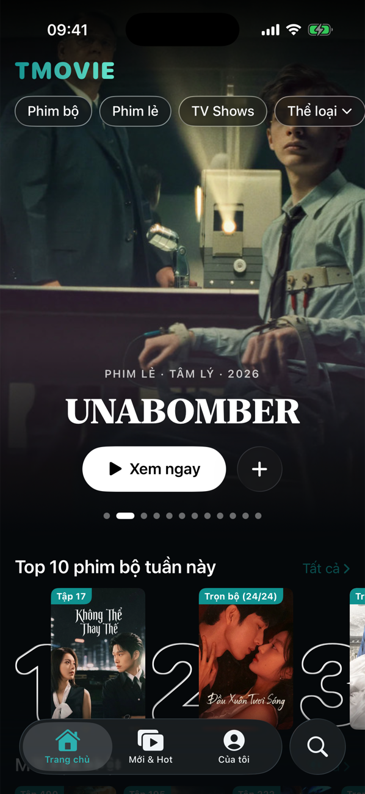
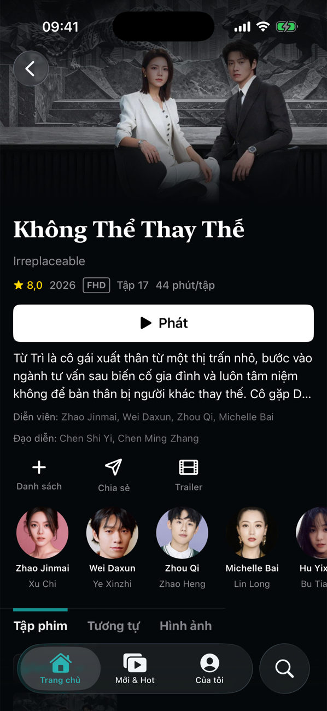
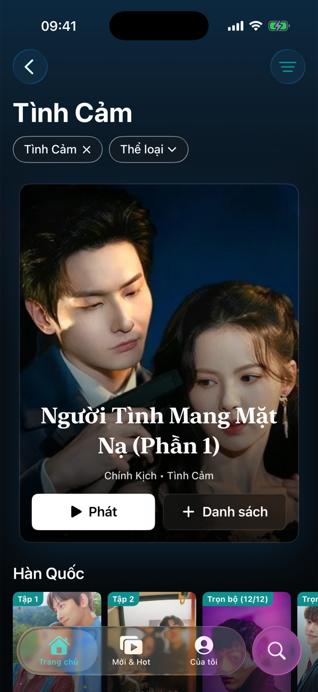
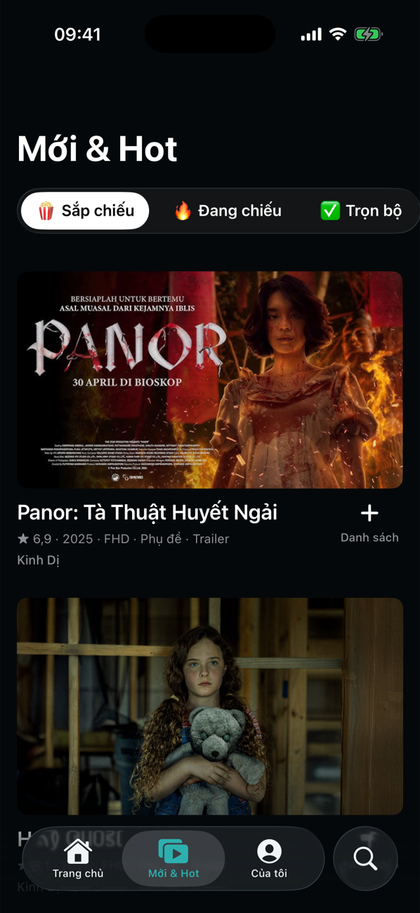
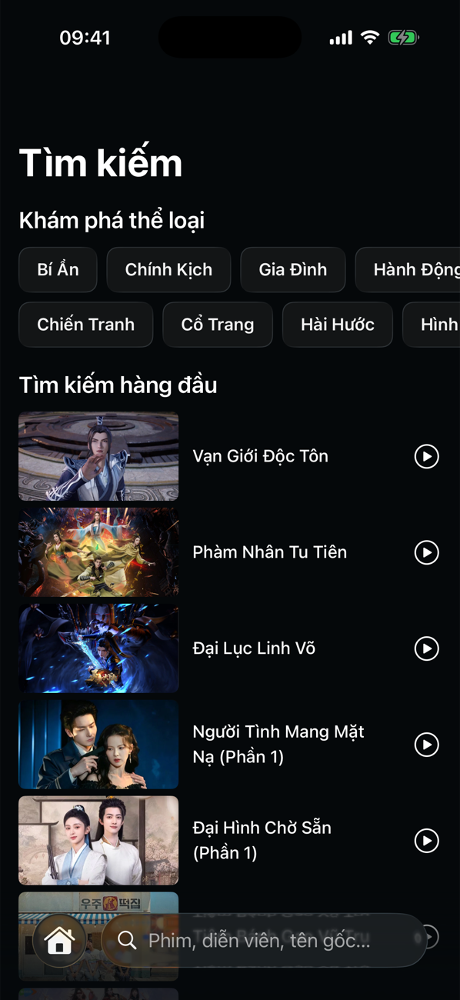
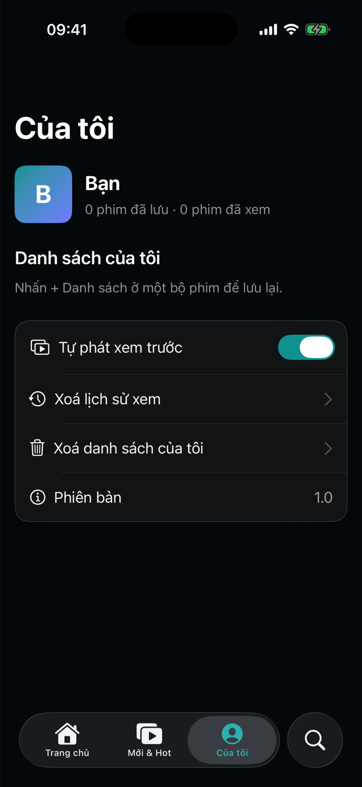
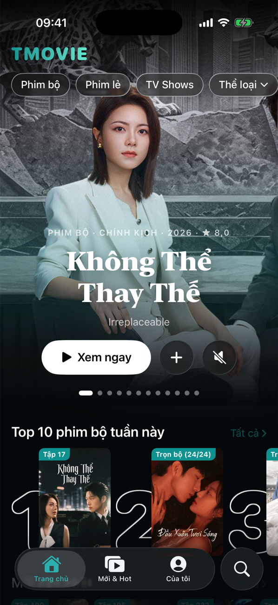

# TMovie

[](https://developer.apple.com/xcode/swiftui/)
[](https://developer.apple.com/ios/)
[](https://firebase.google.com)
[](https://opensource.org/licenses/MIT)

**TMovie** is a native movie and series streaming app with an Apple TV-inspired, cinematic design:
- full-bleed key art and autoplay previews,
- Liquid Glass surfaces,
- Netflix-style browsing,
- a real "what's hot in Vietnam" list.

| <br><sub><b>Home</b></sub> | <br><sub><b>Detail</b></sub> | <br><sub><b>Category</b></sub> |
| :---: | :---: | :---: |
| <br><sub><b>New & Hot</b></sub> | <br><sub><b>Search</b></sub> | <br><sub><b>Profile</b></sub> |
| <br><sub><b>Onboarding</b></sub> | | |

---

## ✨ Features

- 🎞 **Apple TV-style hero**: full-bleed, textless key art.
  - Paging parallax, a slow Ken Burns drift, depth from device tilt, and a tint sampled from the artwork.
  - After a moment, a **muted preview of the film** fades in, with a mute toggle.
- 🔥 **What's hot, for real**: the hero and "Top 10 phim bộ tuần này" follow **Netflix's weekly Top 10 for Vietnam**, crawled every 6 hours and matched to playable films (see [Hot list](#-hot-list)).
- 🧊 **Liquid Glass** on iOS 26 (glass tab bar, chips and buttons), with material fallbacks on iOS 17–18.
  - Poster → detail **zoom transitions** on iOS 18+.
- 📺 **Netflix-style browsing**:
  - Category pages with a full-screen genre picker, a featured card, shelves by country, and an endless filtered grid.
  - New & Hot (upcoming / airing / completed), and Search with genre chips and top searches.
- ▶️ **Native player**: Picture in Picture, AirPlay, landscape, resume at the saved second, and a "next episode" button that also auto-plays.
- 💾 **Your library**: My List, Continue Watching with progress bars, and per-episode resume points, all stored on the device.
- ♿️ **Respects Reduce Motion and Low Power Mode**: parallax, tilt and autoplay previews switch off.
- 🔗 **Deep links**: `tmovie://phim/{slug}` and `tmovie://the-loai/{slug}`.

---

## 🛠 Tech Stack

| Layer | Technology |
| :--- | :--- |
| **UI** | SwiftUI (iOS 17+), Liquid Glass on iOS 26, `@Observable` |
| **Architecture** | Local Swift package `TMovieKit`, one module per layer and feature |
| **Networking** | `URLSession` + async/await + `Codable` |
| **Persistence** | SwiftData |
| **Player** | AVKit (`AVPlayerViewController`) |
| **Project** | [Tuist](https://tuist.dev) |
| **Data** | [PhimAPI](https://phimapi.com) (films, episodes, HLS streams), TMDB images |

---

## 📂 Project Structure

```text
tmovie_ft/
├── ios/
│   ├── App/Sources/            # Thin app target: @main, tab shell, route → screen mapping
│   ├── TMovieKit/Sources/
│   │   ├── Models/  Networking/  Persistence/  DesignSystem/  AppRouter/
│   │   ├── FilmUI/  PlayerFeature/
│   │   └── HomeFeature/  DetailFeature/  BrowseFeature/  ProfileFeature/  OnboardingFeature/
│   ├── TMovieKit/Tests/        # Decoding + URL tests against recorded PhimAPI JSON
│   └── Tools/make_icon.swift   # Generates the app icon
├── tools/hot/crawl_hot.py      # Hot-list crawler (Netflix Top 10 Vietnam → PhimAPI)
├── .github/workflows/          # Hot-list cron, release builds
└── apps/, packages/            # Legacy Flutter apps (mobile, Android TV)
```

Features depend only on the foundation and shared UI modules (`FilmUI`, `PlayerFeature`) and never import each other. They push `FilmRoute` / `ListRoute` values, and the app target maps those to screens.

---

## 🔥 Hot List

The PhimAPI catalogue can't be sorted by popularity, so "what's hot" comes from outside:

1. [`tools/hot/crawl_hot.py`](tools/hot/crawl_hot.py) reads Netflix's public weekly Top 10 for Vietnam (TV and films).
2. It searches PhimAPI for each title and matches by original name.
3. [`.github/workflows/hot.yml`](.github/workflows/hot.yml) runs the crawler every 6 hours. It publishes the result as `hot.json` on the `hot-data` branch, a single force-pushed commit.
4. The apps read `https://raw.githubusercontent.com/qthien202/tmovie_ft/hot-data/hot.json`. If that's unavailable, they fall back to ranking currently updating titles by view count.

---

## 🚀 Getting Started

**Requirements:** Xcode 26, [Tuist](https://tuist.dev) 4, and an iPhone or simulator on iOS 17 or later.

```bash
git clone https://github.com/qthien202/tmovie_ft.git
cd tmovie_ft/ios
tuist generate              # creates TMovie.xcworkspace (gitignored)
open TMovie.xcworkspace     # set your signing team, then run
```

Run the tests:
```bash
cd ios/TMovieKit
xcodebuild test -scheme TMovieKit -destination 'platform=iOS Simulator,name=iPhone 17'
```

Run the crawler locally (Python 3, standard library only):
```bash
python3 tools/hot/crawl_hot.py hot.json
```

---

> Content comes from a third-party aggregator API. That's fine for personal use, but the app isn't meant for App Store distribution.
