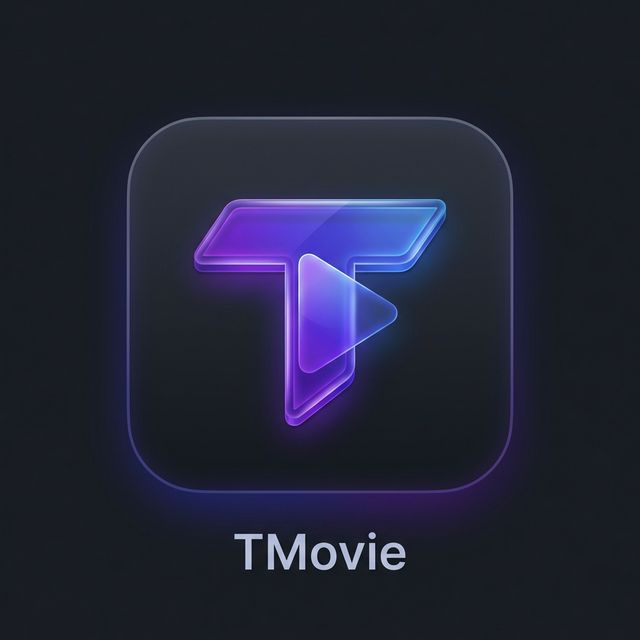
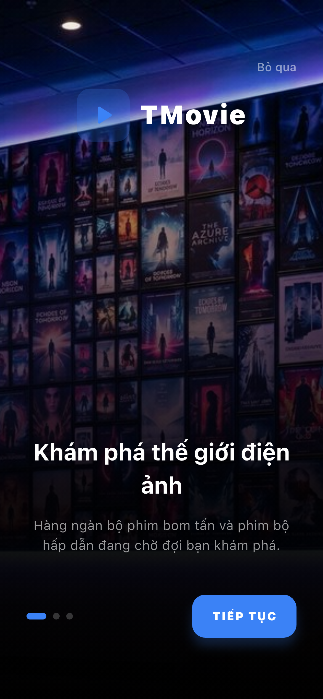
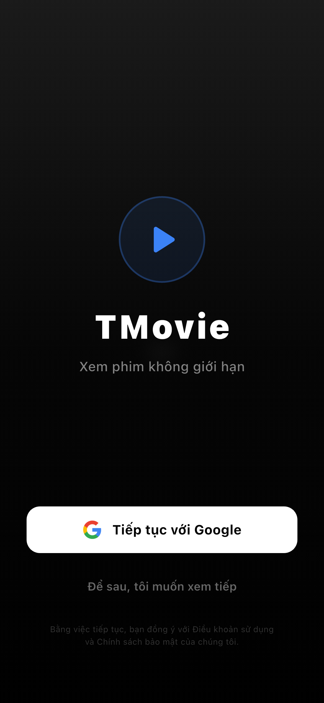
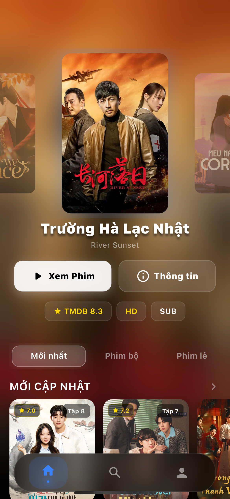
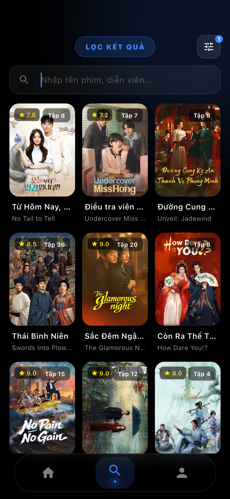
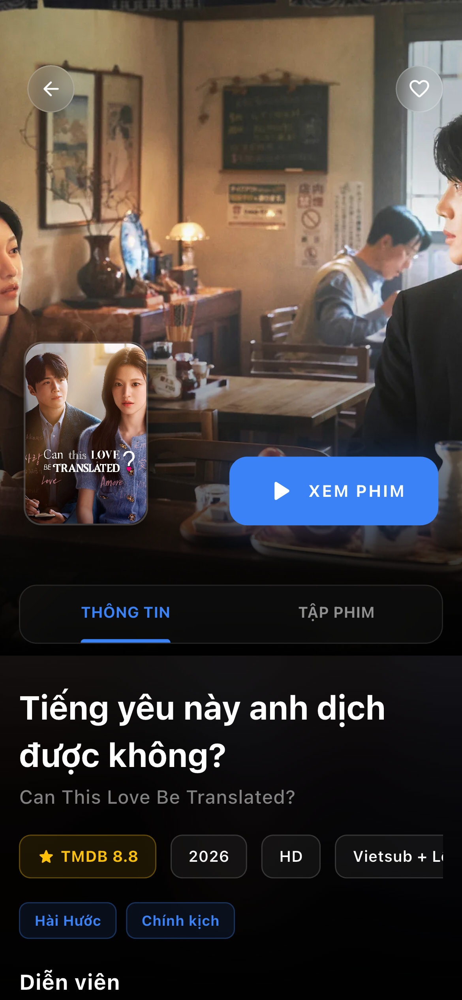
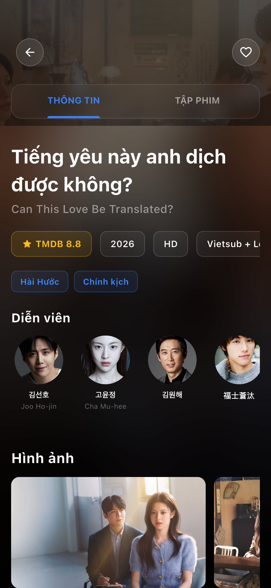
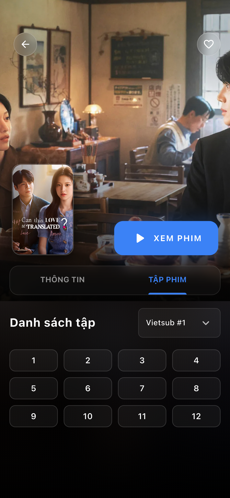

#  TMovie - Premium Cinema Experience

[](https://flutter.dev)
[](https://riverpod.dev)
[](https://developer.apple.com/xcode/swiftui/)
[](https://firebase.google.com)
[](https://opensource.org/licenses/MIT)

**TMovie** is a high-end online movie streaming application, delivering a premium cinema experience directly to your mobile devices (iOS/Android) and Android TV. Built with a modern, smooth design philosophy centered around the user.

---

## ✨ Premium Features

- 🎨 **Glassmorphism UI**: Modern design with luxury frosted glass effects, providing a high-end and sophisticated feel.
- 🎬 **Cinematic Video Player**: 100% custom controller, supporting 10s seek, episode selection, and server switching directly while watching.
- 🔗 **Cloud Sync**: One-tap Google Sign-In to save watch history and favorite movie lists across all devices via Firestore.
- ⚡ **Exceptional Performance**: Built on Flutter with Riverpod State Management for instant response speeds.
- 📺 **Multi-platform Support**: Unified experience from compact mobile screens to sharp 4K TV displays.

---

## 📸 Screenshots

| <br><sub><b>Onboarding</b></sub> | <br><sub><b>Google Login</b></sub> | <br><sub><b>Home Screen</b></sub> |
| :---: | :---: | :---: |
| <br><sub><b>Search & Filter</b></sub> | <br><sub><b>Movie Info</b></sub> | <br><sub><b>Cast & Crew</b></sub> |
| <br><sub><b>Episodes List</b></sub> | | |

---

## 🍎 Native iOS App (SwiftUI)

A native iPhone port of the mobile app lives in [`ios/`](ios/), with its own Apple TV-inspired design. It doesn't touch the Flutter apps.

- 🎞 **Apple TV-style hero**: full-bleed, textless key art with paging parallax, a slow Ken Burns drift, depth from device tilt, and a tint sampled from the artwork.
  - After a moment, a **muted preview of the film** fades in, with a mute toggle.
  - Previews are off with Reduce Motion, in Low Power Mode, or via the setting in Profile.
- 🔥 **What's hot, for real**: the hero and "Top 10 phim bộ tuần này" follow **Netflix's weekly Top 10 for Vietnam**.
  - A GitHub Action crawls it every 6 hours and matches each title to a PhimAPI film (see [`tools/hot`](tools/hot/crawl_hot.py)).
- 🧊 **Liquid Glass** on iOS 26 (glass tab bar, chips and buttons), with material fallbacks on iOS 17–18.
  - Poster → detail **zoom transitions** on iOS 18+.
- 📺 **Netflix-style browsing**:
  - Category pages with a full-screen genre picker, a featured card, shelves by country, and an endless filtered grid.
  - New & Hot (upcoming / airing / completed), Search with genre chips, and Continue Watching with progress bars.
- ▶️ **AVKit player**: Picture in Picture, AirPlay, landscape, resume at the saved second, and a "next episode" button that also auto-plays.
- 💾 **On-device library** with SwiftData: My List, watch history and per-episode resume points.
- 🔗 **Deep links**: `tmovie://phim/{slug}` and `tmovie://the-loai/{slug}`.

| <br><sub><b>Home · Apple TV hero</b></sub> | <br><sub><b>Detail</b></sub> | <br><sub><b>Category</b></sub> |
| :---: | :---: | :---: |
| <br><sub><b>New & Hot</b></sub> | <br><sub><b>Search</b></sub> | <br><sub><b>Profile</b></sub> |
| <br><sub><b>Onboarding</b></sub> | | |

| Layer | Technology |
| :--- | :--- |
| **UI** | SwiftUI (iOS 17+), Liquid Glass on iOS 26, `@Observable` |
| **Architecture** | Local Swift package `TMovieKit`, one module per layer and feature |
| **Networking** | `URLSession` + async/await + `Codable` |
| **Persistence** | SwiftData |
| **Player** | AVKit (`AVPlayerViewController`) |
| **Project** | [Tuist](https://tuist.dev) |

```text
ios/
├── App/Sources/          # Thin app target: @main, tab shell, route → screen mapping
├── TMovieKit/Sources/
│   ├── Models/  Networking/  Persistence/  DesignSystem/  AppRouter/
│   ├── FilmUI/  PlayerFeature/
│   └── HomeFeature/  DetailFeature/  BrowseFeature/  ProfileFeature/  OnboardingFeature/
├── TMovieKit/Tests/      # Decoding + URL tests against recorded PhimAPI JSON
└── Tools/make_icon.swift # Generates the app icon
```

Features depend only on the foundation and shared UI modules, never on each other. They push `FilmRoute` / `ListRoute` values, and the app target maps those to screens.

**Build & run** (Xcode 26, [Tuist](https://tuist.dev)):
```bash
cd ios
tuist generate                      # creates TMovie.xcworkspace (gitignored)
open TMovie.xcworkspace             # set your signing team, then run on an iPhone
cd TMovieKit && xcodebuild test -scheme TMovieKit -destination 'platform=iOS Simulator,name=iPhone 17'
```

---

## 🛠 Tech Stack

| App Layer | Technology |
| :--- | :--- |
| **State Management** | `flutter_riverpod` (v2.6+) |
| **Networking** | `dio` + `retrofit` |
| **Navigation** | `go_router` |
| **Video Engine** | `video_player` + `chewie` (Customized) |
| **Backend** | `Firebase Auth` + `Cloud Firestore` |
| **Monorepo** | `Melos` |

---

## 📂 Project Structure

```text
tmovie_ft/
├── apps/
│   ├── mobile/          # 📱 iOS & Android Application
│   └── tv/              # 📺 Android TV Application (Leanback)
├── packages/
│   └── core/            # 📦 Shared: models, API, providers, widgets
├── ios/                 # 🍎 Native SwiftUI iPhone app (see above)
├── tools/hot/           # 🔥 Hot-list crawler (Netflix Top 10 Vietnam → PhimAPI)
└── screenshots/         # 🖼 App Screenshot Gallery
```

---

## 🚀 Getting Started

### System Requirements
- Flutter SDK >= 3.38.0
- Dart SDK >= 3.8.0
- Melos (`dart pub global activate melos`)

### Setup Steps
1. **Clone the repository:**
   ```bash
   git clone https://github.com/qthien202/tmovie_ft.git
   cd tmovie_ft
   ```

2. **Initialize dependencies:**
   ```bash
   melos bootstrap
   ```

3. **Auto-generate code (Models/Retrofit):**
   ```bash
   melos run build_runner
   ```

4. **Configure Firebase (required):**

   This project uses Firebase for Google Sign-In and cloud sync. You need to create your own Firebase project:

   **Step 1**: Go to [Firebase Console](https://console.firebase.google.com) → Create a new project

   **Step 2**: Add your apps to the Firebase project:
   - **Android**: Add Android app with package name `com.thientech.mobile` (or your own)
   - **iOS**: Add iOS app with bundle ID `com.thientech.mobile` (or your own)

   **Step 3**: Download and place config files:
   ```text
   apps/mobile/android/app/google-services.json    ← from Firebase (Android)
   apps/mobile/ios/Runner/GoogleService-Info.plist  ← from Firebase (iOS)
   ```
   > See `.example` files in these directories for reference.

   **Step 4**: Create `apps/mobile/lib/firebase_options.dart` from the template:
   ```bash
   cp apps/mobile/lib/firebase_options.dart.example apps/mobile/lib/firebase_options.dart
   ```
   Then replace the placeholder values with your Firebase project config (found in Firebase Console → Project Settings).

   **Step 5** (iOS only): Update `CFBundleURLSchemes` in `apps/mobile/ios/Runner/Info.plist`:
   - Open your downloaded `GoogleService-Info.plist`, find the `REVERSED_CLIENT_ID` value
   - Replace the existing `com.googleusercontent.apps.xxx` value in `Info.plist` → `CFBundleURLSchemes` with your reversed client ID

   **Step 6**: Enable Firebase services:
   - **Authentication** → Sign-in method → Enable **Google**
   - **Cloud Firestore** → Create database → Start in **test mode**

   **Firestore Security Rules** (recommended for production):
   ```javascript
   rules_version = '2';
   service cloud.firestore {
     match /databases/{database}/documents {
       match /users/{userId}/{document=**} {
         allow read, write: if request.auth != null && request.auth.uid == userId;
       }
     }
   }
   ```

5. **Run the application:**
   ```bash
   # Mobile
   cd apps/mobile && flutter run

   # TV
   cd apps/tv && flutter run
   ```

---

## 📖 Documentation
- 🏗 [System Architecture](docs/architecture.md)
- 🔌 [API Details (OPhim)](docs/api.md)
- 📝 [Feature List](docs/features.md)

---

<p align="center">
  Made with ❤️ by <b>TMovie Team</b>
</p>
